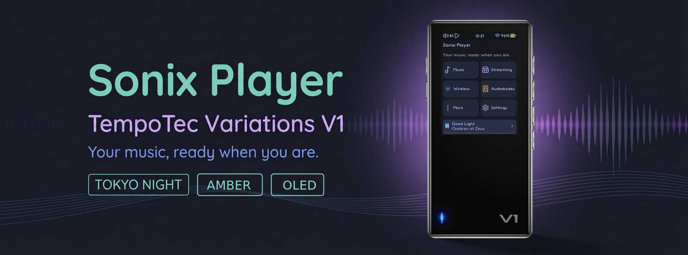
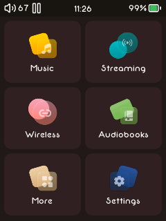
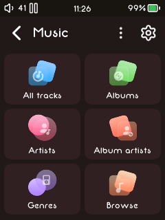
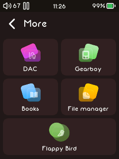
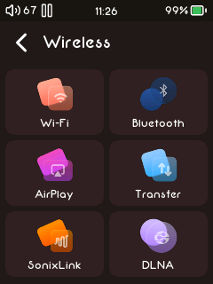
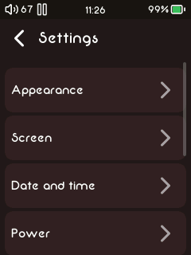
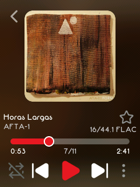
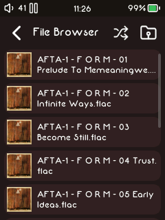
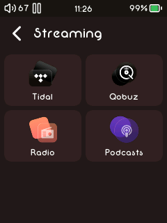
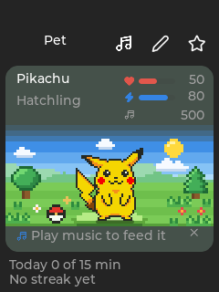

This repository is originally a **TempoTec Variations V1** community port of the original **[Sonix Player](https://github.com/Jepl4r/sonix-player)** project by **[Jepl4r](https://github.com/Jepl4r)** (now **[Tartarus](https://github.com/Tartarus6)**) made for the Hiby R1 & the HiBy R3 Pro II, before it became much more than just a simple *port*, it's almost a brand new firmware and is basically Sonix but on *steroids*,perfectly optimized for v1's small little screen,with tons of features, you wouldn't have suspected your DAP could have!

The firmware builder starts with an official V1 1.3 update package, replaces the stock music player and its interface with Sonix, then repackages the update as `v1.upt`.

You can now try Sonix in the **[Tempotec V1](https://mr-f0xx.github.io/sonix-player-tempotec-v1/)** browser emulator I made (PC & Mobile compatible)

The web workbench also has a [Live USB tab](tools/v1-emulator/README.md#live-usb-connect-a-physical-v1) for editing PEQ presets, Tape Deck kits, and playlists on a physical V1 and downloading its debug log.

## Previews

Expand a theme to see its screenshots. Select a screenshot to view it full size.

<a name="default-theme"></a>

<details>
<summary><strong>Default theme</strong></summary>

These screenshots use a custom font and color.

<table>
  <tr>
    <td align="center">
      <a href="screenshots/main-menu.png"></a>
      <br><sub><b>Main menu</b></sub>
    </td>
    <td align="center">
      <a href="screenshots/music.png"></a>
      <br><sub><b>Music</b></sub>
    </td>
    <td align="center">
      <a href="screenshots/more.png"></a>
      <br><sub><b>More</b></sub>
    </td>
    <td align="center">
      <a href="screenshots/wireless.png"></a>
      <br><sub><b>Wireless</b></sub>
    </td>
  </tr>
  <tr>
    <td align="center">
      <a href="screenshots/settings.png"></a>
      <br><sub><b>Settings</b></sub>
    </td>
    <td align="center">
      <a href="screenshots/now-playing.png"></a>
      <br><sub><b>Now Playing</b></sub>
    </td>
    <td align="center">
      <a href="screenshots/file-browser.png"></a>
      <br><sub><b>File Browser</b></sub>
    </td>
    <td align="center">
      <a href="screenshots/streaming.png"></a>
      <br><sub><b>Streaming</b></sub>
    </td>
  </tr>
</table>
</details>

<a name="tokyo-night-theme"></a>

<details>
<summary><strong>Tokyo Night theme</strong></summary>

Showcase of **Tokyo Night** appearance: a blue-black palette with function-matched icons.

<table>
  <tr>
    <td align="center">
      <a href="screenshots/tokyonight/main-menu.png"></a>
      <br><sub><b>Main menu</b></sub>
    </td>
    <td align="center">
      <a href="screenshots/tokyonight/music.png"></a>
      <br><sub><b>Music</b></sub>
    </td>
    <td align="center">
      <a href="screenshots/tokyonight/more.png"></a>
      <br><sub><b>More</b></sub>
    </td>
    <td align="center">
      <a href="screenshots/tokyonight/wireless.png"></a>
      <br><sub><b>Wireless</b></sub>
    </td>
  </tr>
  <tr>
    <td align="center">
      <a href="screenshots/tokyonight/settings.png"></a>
      <br><sub><b>Settings</b></sub>
    </td>
    <td align="center">
      <a href="screenshots/tokyonight/now-playing.png"></a>
      <br><sub><b>Now Playing</b></sub>
    </td>
    <td align="center">
      <a href="screenshots/tokyonight/file-browser.png"></a>
      <br><sub><b>File Browser</b></sub>
    </td>
    <td align="center">
      <a href="screenshots/tokyonight/streaming.png"></a>
      <br><sub><b>Streaming</b></sub>
    </td>
  </tr>
</table>
</details>

<a name="amber-on-black-theme"></a>

<details>
<summary><strong>Amber on Black theme</strong></summary>

Showcase of **Amber** appearance: fiery orange accents on a pure black background, with warm amber artwork and glowing icons.

<table>
  <tr>
    <td align="center">
      <a href="screenshots/ember/main-menu.png"></a>
      <br><sub><b>Main menu</b></sub>
    </td>
    <td align="center">
      <a href="screenshots/ember/music.png"></a>
      <br><sub><b>Music</b></sub>
    </td>
    <td align="center">
      <a href="screenshots/ember/more.png"></a>
      <br><sub><b>More</b></sub>
    </td>
    <td align="center">
      <a href="screenshots/ember/wireless.png"></a>
      <br><sub><b>Wireless</b></sub>
    </td>
  </tr>
  <tr>
    <td align="center">
      <a href="screenshots/ember/settings.png"></a>
      <br><sub><b>Settings</b></sub>
    </td>
    <td align="center">
      <a href="screenshots/ember/now-playing.png"></a>
      <br><sub><b>Now Playing</b></sub>
    </td>
    <td align="center">
      <a href="screenshots/ember/file-browser.png"></a>
      <br><sub><b>File Browser</b></sub>
    </td>
    <td align="center">
      <a href="screenshots/ember/streaming.png"></a>
      <br><sub><b>Streaming</b></sub>
    </td>
  </tr>
</table>
</details>

<a name="oled-theme"></a>

<details>
<summary><strong>OLED theme</strong></summary>

Showcase of **OLED** appearance: true black backgrounds with white as the accent, on the same V1 layouts as Tokyo Night and Amber.

<table>
  <tr>
    <td align="center">
      <a href="screenshots/oled/main-menu.png"></a>
      <br><sub><b>Main menu</b></sub>
    </td>
    <td align="center">
      <a href="screenshots/oled/music.png"></a>
      <br><sub><b>Music</b></sub>
    </td>
    <td align="center">
      <a href="screenshots/oled/more.png"></a>
      <br><sub><b>More</b></sub>
    </td>
    <td align="center">
      <a href="screenshots/oled/wireless.png"></a>
      <br><sub><b>Wireless</b></sub>
    </td>
  </tr>
  <tr>
    <td align="center">
      <a href="screenshots/oled/settings.png"></a>
      <br><sub><b>Settings</b></sub>
    </td>
    <td align="center">
      <a href="screenshots/oled/now-playing.png"></a>
      <br><sub><b>Now Playing</b></sub>
    </td>
    <td align="center">
      <a href="screenshots/oled/file-browser.png"></a>
      <br><sub><b>File Browser</b></sub>
    </td>
    <td align="center">
      <a href="screenshots/oled/streaming.png"></a>
      <br><sub><b>Streaming</b></sub>
    </td>
  </tr>
</table>
</details>

## Contents

- [Target device](#target-device)
- [Features](#features)
- [Previews](#previews)
  - [Default theme](#default-theme)
  - [Tokyo Night theme](#tokyo-night-theme)
  - [Amber on Black theme](#amber-on-black-theme)
  - [OLED theme](#oled-theme)
- [Custom theme](#custom-theme)
- [Video](#video)
- [Music pet](#music-pet)
- [Tag Manager](#tag-manager)
- [Tape Deck](#tape-deck)
- [Wi-Fi file transfer](#wi-fi-file-transfer)
- [Download from WebDAV or FTP](#download-from-webdav-or-ftp)
- [Build a firmware image](#build-a-firmware-image)
- [Install or restore firmware](#install-or-restore-firmware)
- [Streaming: Tidal, Qobuz and credentials](#streaming-tidal-qobuz-and-credentials)
- [SoundCloud](#soundcloud)
- [Subsonic / Gonic](#subsonic--gonic)
- [Jellyfin](#jellyfin)
- [Build from source](#build-from-source)
- [Project files and documentation](#project-files-and-documentation)
- [Collecting logs for a bug report](docs/collecting-logs.md)
- [Credits](#credits)

## Target device

The **TempoTec Variations V1**:

| Component | Specification |
|---|---|
| **SoC** | Ingenic X1600 (MIPS32r2 core, o32 ABI, glibc 2.22 compatibility) |
| **Display** | 2.0-inch QVGA TFT panel, **240×320 pixels** portrait |
| **DAC** | Dual Cirrus Logic CS43131 |
| **Audio Outputs** | 3.5 mm single-ended + 4.4 mm balanced headphone jacks |
| **Storage** | One MicroSD card slot (exFAT / FAT32) |
| **Controls** | Side flank buttons (Power, Vol+, Vol-, Play/Pause, Next/Prev) + capacitive touchscreen |
| **Wireless** | 2.4 GHz Wi-Fi (802.11 b/g/n) and bi-directional Bluetooth |
| **USB** | USB Type-C (bidirectional USB DAC & USB audio out) |
| **Firmware Package** | `v1.upt` with accompanying `v1_md5.txt` |

The player UI is built with LVGL 9.6 and adapted for the V1's small display. The package is based on vendor firmware; it is **not** a Linux distribution or a kernel replacement.

## Features

This fork builds on the upstream [Sonix Player](https://github.com/Jepl4r/sonix-player) for the V1. The items below are **new in this fork**; everything else is shared with upstream. The complete list is in [FEATURES.md](FEATURES.md).

### 🌟 New in this fork

- 🔀 **Equal-power crossfade** - under **Settings → Music → Playback options → Fade & Crossfade**, overlap automatic track transitions by 1 to 10 seconds with an equal-power curve — resampling, mapping mono/stereo and applying per-track ReplayGain across mixed-format queues — or choose sequential **Fade out / in**. Manual skips still cut cleanly.
- 📊 **Listening statistics** - open **Music → Stats** to see how long you listened and which tracks, albums and artists you played most. Switch between week, month, year and all time. The seven-day chart is Monday-first with today highlighted (later weekdays are from the previous week). The current calendar month highlights today and shows each numbered day in a compact horizontally scrollable chart; the current year shows one bar per month and all time shows one bar per year. A play is counted once half the track — or four minutes of a longer one — has actually been heard, so skipping through a queue no longer inflates the numbers on this page or in **Most played**.
- 🖼️ **2×2 album & browser cover grids** - browse albums by cover art four at a time, and optionally show folder artwork (**Browse folder covers**) or a 2×2 cover grid for folders and tracks (**Browse cover grid**) inside `Music` under **Settings → Music → Library**.
- 📺 **DLNA casting** - cast local tracks from the V1 to TVs and speakers on the same Wi-Fi, alongside acting as a DLNA renderer. Pick a target from the cast overlay on **Wireless → DLNA** or cast in one tap from the Now Playing menu (**Cast to a DLNA renderer**); streams are served directly from microSD with HTTP byte-range seeking, renderer-matched DLNA profiles, and automatic FLAC-to-WAV fallback for TVs that refuse native FLAC.
- 🎬 **MPEG-1 video player** - open a `.mpg`, `.mpeg`, `.mpe`, `.mpv` or `.m1v` file in **Files** and watch it on the V1 itself. The X1600 has no hardware H.264/HEVC decoder, so MPEG-1 video with MP2 audio is decoded in software and blitted straight to the framebuffer, rotated to the panel and played landscape by default. A scrub bar on the panel edge appears with the remaining time, play/pause state and dragging to seek, then hides after three seconds; tap the picture to pause, double-tap to switch between landscape and portrait, and use the side keys for **Next/Previous ±30 s** and play/pause, with the volume keys keeping their usual job. Audio is clocked from ALSA, so a slow decode drops frames instead of letting the sound drift. The emulator workbench's **Video** tab carries ffmpeg presets that turn any file into a V1-friendly `.mpg` (320×240, 24 fps, moderate bitrate).
- 🔧 **Live USB workbench** - connect a physical V1 to a desktop or Android browser over **WebUSB** (with **ADB** on under Settings → Developer options) and work on the card directly from the [workbench](https://mr-f0xx.github.io/sonix-player-tempotec-v1/)'s **Live USB** tab: draw a **PEQ** curve with draggable bands or import/export an APO preset, lay WAVs out across the **Tape Deck**'s sixteen pads into a new `Drum Kits/` folder, edit and reorder **M3U** playlists, and download the player's debug log. Saves always use a new name, so an existing preset, kit or playlist is never replaced by accident, and nothing is uploaded to a server. See the [Live USB guide](tools/v1-emulator/README.md#live-usb-connect-a-physical-v1).
- 🎧 **Listen Together** - open **Streaming → Listen Together** on two V1s on the same Wi-Fi. Tap **Start Hosting** on the one playing music and **Join Stream** on the other to listen in sync.
- 📼 **Tape Deck** - the optional [More → Tape Deck](docs/tape-deck.md) sampler has 16 pads for factory drums or your own WAVs. Trim and slice samples, play chromatic 16-Levels with linear/cubic resampling, and use choke groups. Overdub a one-bar loop, save the editable sequence or record the stereo mix to microSD with live filter, echo and drive. Add a compatible capture input to record WAV voice memos.
- 🔁 **A-B loop and Now Playing actions** - mark two points in the track menu to repeat a passage on a seekable track; both marks appear on the progress bar. Hold the album sleeve for half a second to open the playback queue directly without opening the menu, use **Back** to return to the previous screen, cast the current track over DLNA, or — with **Allow deleting tracks** enabled — **Delete track** from microSD after confirmation.
- 🎤 **Lyrics overlay, text size, timing offset & title-only search** - swipe left on the artwork for a full-height lyrics overlay that follows your player status bar setting, choose **Small**, **Normal** or **Large** lyrics text (**Aa**) independently of the UI font size, nudge synced lyrics earlier or later in `0.1s` steps per track without editing the `.lrc` file, and search LRCLIB by title alone (with preview) when artist lookup finds no match or the artist tag is missing.
- 📲 **Wi-Fi folder uploads** - pair a browser with [Wireless → Transfer](docs/wi-fi-transfer.md) by QR or session code on trusted Wi-Fi, then drop whole album folders onto microSD with their paths intact.
- 🎙️ **Offline podcast catcher** - an opt-in module (`podcastcatcher` under **Settings → Plugins**) that reads a `feeds.txt` from the card root, one feed per line, and downloads each show's newest episodes into the `Podcast` folder as ordinary files whenever Wi-Fi joins a network — and once at start-up if the radio is already up. The first check of a feed takes only its newest few episodes and records the rest as seen, so a years-old back catalogue cannot fill the card; later checks take only what is genuinely new, a failed download is retried on the next connection, and a `min_free_mb` floor stops it before the card is full. Each episode is bookmarked as it plays, so opening it again carries on where it was left. It is never switched on by a firmware update, because it fetches and writes on its own. See [Offline podcast catcher](#offline-podcast-catcher).
- 🗂️ **WebDAV and FTP downloads** - in [Streaming → Network folders](docs/network-folders.md), browse a server and save a track or the current folder's music to `Music/Network Downloads` on microSD. **Save and play** opens the local file once the download finishes. Optionally, **Remember password** keeps the password across reboots — unencrypted, in a private device-local file — or leaves it off so it stays in memory until restart.
- 💡 **Smart LED and Stealth mode** - choose Bass Pulse, Energy Glow or Rainbow Breath, 10 brightness steps and transition speed under [Settings → Power](docs/sgm31324-led-control.md#smart-led-and-stealth-mode). Three red blinks warn at 5% battery; green blinks confirm Wi-Fi uploads and newly found OTA releases. Stealth keeps the light off even while charging.
- 🔋 **Battery profiler and charge history** - in [Settings → System → Battery profiler](docs/battery-profiler.md), check voltage and estimated runtime or compare estimated draw against a saved baseline. Charge history shows when the battery reached its target or was unplugged, and how long the player has been on since.
- 💾 **SD card health benchmark** - [Settings → System → SD card health](docs/sd-card-health.md) runs a five-second, read-only 4K sequential/random read test with sparse beginning/middle/end probes, reporting MB/s, IOPS, slow blocks and read errors before a cheap, worn or counterfeit card starts corrupting music. It runs off the UI thread, writes nothing, and refuses to start during USB sharing.
- 🔌 **Themed charging screen** - the off-state battery screen uses your theme and checks for a connected cable even when the 80% charge limit has paused charging.
- 🖥️ **V1 browser emulator** - [try Sonix on a phone or computer](https://mr-f0xx.github.io/sonix-player-tempotec-v1/) without flashing a player. Use the touchscreen and side buttons, or load your own music onto the virtual microSD. It follows the latest published web firmware. To test your changes, drop the `sonix-v1-web-wasm` Actions artifact ZIP for your commit into **Firmware Builds**, or use **Rebuild & boot local** in the native bridge. See the [emulator guide](tools/v1-emulator/README.md#testing-a-firmware-change). A **Video** tab also carries copyable ffmpeg presets for the MPEG-1 video player above, so a file dropped onto the card plays on the V1 rather than only on a computer.
- 🔗 **Fork QR code** - scan the code under **Settings → System → About → Forked by** to open this repository on your phone. The V1 can display the code offline.
- 🐾 **Music pet** - a Pikachu that grows from the music you hear. See [Music pet](#music-pet).
- 🧮 **Calculator, Notes, Metronome** - a pocket calculator, text notes from the card, and a metronome with tap tempo, all under More.
- 🎮 **2048, Snake and Dino** - three small games under More, sized for the V1 panel. Gearboy also gains a cover-art grid and a game-audio mute so you can keep listening to music while playing.
- 🏷️ **Tag Manager** - view and edit FLAC, MP3, M4A, AAC, Opus and Ogg tags and cover art, and search for covers over Wi-Fi. See the [usage and safety notes](docs/tag-manager.md).
- 🏠 **Subsonic / Gonic** - stream from [your own server](#subsonic--gonic), or [save tracks and albums](docs/subsonic.md#saving-music-to-the-sd-card) to `Music/Subsonic Downloads` for offline listening.
- 🪼 **Jellyfin** - stream from your own Jellyfin music server with **Quick Connect** (6-digit code + QR) or username/password (token-only `0600` persistence), **Direct Play** original files or server-side MP3/Opus transcoding, browsing across Folders, Playlists, Artists, Albums (A–Z / Recently added), Genres, Favourites and Search, extendable microSD playback cache with lookahead prefetch, offline saves (`Music/Jellyfin`), live favourite sync, and Jellyfin playback reporting. See [Jellyfin](#jellyfin) and [docs/jellyfin.md](docs/jellyfin.md).
- ☁️ **SoundCloud** - native SoundCloud streaming across anonymous, Free, Go and Go+ tiers: search and play public tracks out of the box without API keys (automatic web `client_id` discovery and rotation), browse Likes, Reposts and Playlists by profile URL / username or `oauth_token`, and stream **Opus 64k**, **MP3 128k** or **Go+ AAC 256k** with an extendable microSD cache (**512 MB** default, up to **1 GB**, **2 GB**, **4 GB**, **8 GB**, or **Unlimited** directly in-app), lookahead prefetch, discreet non-blocking loading spinners, and Now Playing **Like** / **Keep** support. See [SoundCloud](#soundcloud) and [docs/soundcloud.md](docs/soundcloud.md).
- 🌊 **One-tap Tidal & Qobuz setup + streaming upgrades** - extract the official V1 stock credentials directly on the player over Wi-Fi or from the microSD card (no PC, developer keys or restart needed). Includes V1-adapted **Tidal** with offline downloads (`Music/Tidal/<artist>/<album>`), a configurable SD playback cache (512 MB, 1/2/4/8 GB or unlimited), cached lists, favourite playlists, search history, configurable home rows and bulk selection; **Qobuz** up to 24-bit/192 kHz FLAC with full JWT session persistence, plus offline track and album downloads to `Music/Qobuz Downloads`; **FLAC internet radio** with a V1-sized page and Flylo's curated chill-hop picks; and upgraded **Podcasts** (keyless Apple directory with RSS fallback for long shows, heard/unheard tracking, episode ordering and regional charts). See [Streaming: Tidal, Qobuz and credentials](#streaming-tidal-qobuz-and-credentials).
- 🧩 **Plugins (`Settings → Plugins`)** - switch optional modules (including Tidal, Qobuz, SoundCloud, Podcasts, Radio, tools and games) on or off so unused pages are never built and RAM stays free. See [docs/ADDONS.md](docs/ADDONS.md).
- 🎨 **V1 themes, named SD palettes & HSV accent picker** - **Tokyo Night**, **Amber on Black** and **OLED**, designed for the V1 panel, beside Dark and Light. Keep multiple `.ini` palettes in `Themes/` on the SD card — made from the [custom theme template](#custom-theme) or the ready-made **Gruvbox**, **Rosé Pine**, **Dracula** and **Catppuccin Mocha** files — and switch between them in **Settings → Appearance → Custom theme**, opt them into the compact V1 chrome with **Tokyo layout for custom themes**, or dial in any hue, saturation and brightness with the built-in **HSV accent colour picker**.
- 🖼️ **Icon sets** - change the artwork of the whole interface from the SD card, with four sets matching those ready-made palettes (Gruvbox, Rosé Pine, Dracula, Catppuccin Mocha) in `Icons/<set>/`, picked in **Settings → Appearance → Icon set**. Nothing is baked into the firmware; see [docs/icon-sets.md](docs/icon-sets.md).
- 🚀 **Boot screens & boot brightness** - Retrospace (the default), Space, Travelling in space, Stock, or your own **Custom bootlogo** (`Bootlogo/` on the SD card), with a separate 5%–100% **Boot brightness** control so a late-night power-on need not light the room.
- 🖼️ **Player layouts** - **Immersive**, **Poster**, **Album Art Max**, **Vinyl** and **Sticker**, beside Standard, Waveform and Alternative. See [FEATURES.md](FEATURES.md#now-playing) for the details of each layout.
- 🔘 **Legacy play button and corner roundness** - the original round disc behind play and pause, as an option under Settings → Music → Display options; and a slider for how round the screen corners are, from a hint of a corner (2 px) up to 20 px, for a V1 that looks boxier than its 16 px default.
- 🔤 **Interface fonts** - choose MiSans or Neon 80s, or any `.ttf`/`.otf` in the card's `Fonts` folder. Missing glyphs fall back to MiSans, so every language stays readable.
- 🎚️ **Two PEQ profiles** - separate bands, preamp and on/off states for two pairs of headphones, with one-tap switching from the Control Centre, a long press to open the PEQ page, numeric entry when tapping a band's frequency, gain or Q, and an **Automatic level** switch for manual vs automatic EQ/MSEB headroom.
- 🔊 **Volume as voltage** - Settings → Screen can show the nominal RMS output voltage for the selected 3.5 mm or 4.4 mm jack instead of the 0–100 scale. Bluetooth and USB keep the usual scale.
- 🎛️ **Editable control centre** - a second page with ten quick toggles (airplane mode, crossfeed, soundfield, replay gain, mono, key lock, LED, rotate, screen off and the power menu), **edit mode** to swap tiles in place by long press, and an optional **Both sliders** mode under Settings → Screen that shows brightness + volume, brightness + Soundfield, or volume + Soundfield rails (pick the pair with the same three pills).
- 📥 **Control centre over Bluetooth in** - the swipe-down menu stays available while the player is a Bluetooth receiver: volume, brightness and the EQ / MSEB / PEQ switches, with the phone's track on the card, and a long press on EQ, MSEB or PEQ opens that page without ending the stream. See [FEATURES.md](FEATURES.md#wireless).
- 🏅 **Hi-Res badge** - choose the top-left or top-right corner per layout and one of four designs: two-line text, one line, HR, or the official gold Hi-Res Audio logo. With the Vinyl art shape, Standard, Waveform, Alternative and Vinyl put the badge in the header instead of over the sleeve. Off by default.
- 📊 **Dual Scrobbler Suite** (Last.fm & ListenBrainz) - native background scrobbling for both services with independent toggles, token-based setup, and offline queue caching when disconnected from Wi-Fi.
- 🔄 **Over-The-Air (OTA) Updates** - check for and download new releases directly over Wi-Fi from GitHub Releases with one click in Settings → System → Firmware update. The release notes are shown there too, with the parts a screen like this cannot use or need removed: the banner image, the raw pull-request links, the `by @user` attribution and the "**Full Changelog**" compare line. The release page keeps them; the device shows the changelog itself. A background check also runs when Wi-Fi connects and every six hours while it is connected, and — when a new release is found — blinks the LED, puts a dot in the top status bar (tap it) and asks whether to update now; the same check is governed by **Settings → System → Update notifications**, a transient toast reports a deferral, and a deferred release stays remembered per tag so it never nags twice; once the update is made, the release is remembered on disk and the notice — dot, LED blink and popup — does not come back for it, this boot or any later one, and a remembered deferral for that release is dropped.
- 🎵 **Smart Mix playlists** - start from one track to build a playlist of similar songs from the tags on the card, with no network needed. [Smart Mix indexing](FEATURES.md#smart-mix) supports libraries of tens of thousands of tracks without loading the whole library into RAM.
- 💿 **Multi-file CUE sheets & Opus R128 ReplayGain** - a `.cue` can reference several audio files (finding each referenced file by stem even when its extension differs from the `FILE` line), and ReplayGain supports Opus `R128_TRACK_GAIN` / `R128_ALBUM_GAIN` tags alongside FLAC/MP3/Vorbis tags. See [FEATURES.md](FEATURES.md#supported-audio-formats).
- 📁 **Remembered file browser** - Browse reopens the last folder and scroll position after a restart, and can replace the Music tile on the home screen under Settings → Appearance.
- 🎆 **Screensaver visualizer** - a live spectrum in place of the album art: **Neon** (eight wide segmented bars in the theme's accent colour), **LED** (a sixteen-bar bench analyzer with glowing segments), or **iTunes** — music-reactive sharp ribbons, soft ribbons, sparks and a tunnel, adapted from [Joseph Malam's Sonix Visualiser fork](https://github.com/josephmalam/sonix-visualiser), each layer switched on or off on its own. **Full screen** hides the track info and clock for any of the three, and **Show swipe-up arrow** (**Settings → Screen**) hides the bottom chevron without changing how the screensaver is dismissed. An accent-coloured note stands in when nothing is playing.
- 🔌 **External USB-C DACs** - a switch under Developer options keeps the USB-C port supplying power and acting as host, so dongles the default dual-role setting never brought up (a JCally, an ESR) work; the dongle's own volume control is measured so the knob stays smooth down to zero, and a silent dongle is never routed around. Plugging one in says so by name, and a DAC that accepts only one format is handled by **48 kHz compatibility**, which converts every track to 48 kHz / 16 bit before it leaves the port -- switched on by hand, or by itself the moment a card refuses the track's own format.
- 📶 **Bluetooth improvements** - classic BR/EDR discovery while searching, with the player discoverable, so a car head unit (like a Tesla) can pair to it; Wi-Fi/Bluetooth coexistence (AFH); the panel stays powered while a Bluetooth stream plays so waking it is silent; and the adapter is re-powered before reconnecting to the last headphones.
- 🗣️ **Interface languages** - Ukrainian added; Japanese and Russian restored after they were dropped; a selected language that goes missing falls back to English. The player also reads Japanese MP3 tags written in Shift-JIS or EUC-JP.
- 🖐️ **Stock gestures** - **Settings → Appearance → Stock gestures** swaps the two sheets to the edges the stock firmware uses: Cover Flow down from the top edge, control centre up from the bottom. Off by default. A separate **Swipe up to go home** switch controls the home gesture on non-scrolling screens.
- ✨ **Many more improvements!**

### 🤝 Shared with Sonix Player

- **Music**: a local library with a file browser, albums, artists, genres, playlists, favourites and most played, plus gapless playback, fades, ReplayGain and sleep timers.
- **Sound**: a 10-band graphic EQ, parametric EQ, AutoEq, MSEB, crossfeed, DSD and a DAC page.
- **Lyrics**: read from the file or fetched from LRCLIB.
- **Streaming and podcasts**: Tidal, Qobuz, internet radio, Last.fm, and podcasts with downloads.
- **Audiobooks and e-books**: chapters, bookmarks and speed control, plus an EPUB reader.
- **Wireless**: Wi-Fi, Bluetooth headphones and speakers, a Bluetooth receiver, AirPlay, DLNA, Wi-Fi file transfer and SonixLink.
- **Tools and games**: a file manager, a Game Boy / Game Boy Color emulator, and Flappy Bird.
- **Screen and power**: rounded corners (with a choice of how round), brightness, a screensaver, standby, a low-battery warning, and a battery screen when off.

Local audio decoder inputs include WAV, FLAC, MP3, Ogg Vorbis, Opus, M4A/M4B/MP4, AAC, ALAC, WavPack, APE, AIFF/AIFC, CAF and DSD (DSF/DFF). Streaming services depend on third-party availability and an active account where applicable — see [Streaming: Tidal, Qobuz and credentials](#streaming-tidal-qobuz-and-credentials).

<a name="custom-theme"></a>

## Custom theme

Make your own palette from the template below. Copy it to **`Themes/`** on the microSD card as `custom.ini` (or any `.ini` name — create `Themes` at the card root), edit the eight `#RRGGBB` values, then select it under **Settings → Appearance → Custom theme** (and optionally turn on **Tokyo layout for custom themes**). The same template is in the repository at [`sonix-player/examples/custom-theme.ini`](sonix-player/examples/custom-theme.ini); the full guide, including what each key does and how edits take effect, is in [docs/custom-themes.md](docs/custom-themes.md).

```ini
; Copy this file to Themes/custom.ini in the ROOT of the SD card.
; Edit each #RRGGBB colour. All eight keys are required; no other keys.
; Reopen Appearance after editing, then select Custom.
[theme]
screen_bg = #1a1b26
surface = #24283b
surface_pressed = #2d3554
panel = #16161e
cover_bg = #16161e
text_primary = #c0caf5
text_secondary = #a9b1d6
accent = #7aa2f7
```

Every key in `[theme]` is required. Lines starting with `;` or `#` are comments. Selecting Custom with a missing or invalid file shows an error and keeps the current appearance. See [docs/custom-themes.md](docs/custom-themes.md) for the rest.

Four ready-made palettes — **Gruvbox**, **Rosé Pine**, **Dracula** and **Catppuccin Mocha** — are in [`sonix-player/examples/themes/`](sonix-player/examples/themes/): copy any or all of them into `Themes/` keeping their `.ini` names to switch between them in **Settings → Appearance → Custom theme**, or use one as a starting point for your own colours.

Each of the four also has an **icon set** in [`sonix-player/examples/icon-sets/`](sonix-player/examples/icon-sets/): copy one to `Icons/<set>` on the card and choose it under **Settings → Appearance → Icon set**, and every glyph in the interface wears that palette — same colours, same function matching, artwork instead of tint. The sets live entirely on the card; see [docs/icon-sets.md](docs/icon-sets.md).

## Video

The V1 can play video on its own panel. Open a `.mpg`, `.mpeg`, `.mpe`, `.mpv` or
`.m1v` file in **More → File manager** and it plays in place.

The Ingenic X1600 has no hardware H.264 or HEVC decoder, so there is no pretending
at modern video. What it does have is a fast MIPS core and a framebuffer, so the
player decodes **MPEG-1 video with MP2 audio** in an **MPEG-PS** container in
software, from the vendored [`pl_mpeg`](sonix-player/src/system/video/pl_mpeg.h)
decoder. Frames are converted from YUV420 to RGB565, written straight to the
panel's off-screen page and panned in — LVGL is bypassed entirely while a video
plays, which is what makes it fast enough to be worth watching.

### Turning a file into something the V1 plays

The **[workbench](https://mr-f0xx.github.io/sonix-player-tempotec-v1/)** has a
**Video** tab with copyable ffmpeg presets. The recommended one renders at the
panel's native **320×240** landscape, 24 fps, MPEG-1 video with MP2 audio:

```bash
ffmpeg -i input.mp4 -vf "scale=320:240:force_original_aspect_ratio=decrease,pad=320:240:(ow-iw)/2:(oh-ih)/2,fps=24" \
  -c:v mpeg1video -q:v 6 -c:a mp2 -b:a 128k -ar 44100 -ac 2 output.mpg
```

Copy the resulting `.mpg` to the microSD card and open it from the file manager.
Keep video bitrates modest (**≤ 1.5 Mbps** is a safe ceiling) — the decode is
entirely on the CPU, and a heavier file is one that stutters rather than one that
refuses to play.

### Watching

- **Landscape by default.** A 320×240 frame is rotated 90° clockwise into the
  V1's 240×320 portrait panel and cropped to fill it, so a widescreen video uses
  the whole screen rather than sitting in a letterbox. **Double-tap** the picture
  to switch between landscape and portrait.
- **The overlay.** A tap brings up a control strip with the elapsed and remaining
  time, a play/pause glyph and a progress bar along the panel edge; it hides
  itself again after three seconds, and a tap on a hidden one only brings it
  back. While it is showing, a tap on the picture pauses or resumes and a tap on
  the bar jumps to that point; pressing and sliding along the picture scrubs.
- **The side keys.** **Next** and **Previous** seek **±30 s**, and **Play/Pause**
  pauses and resumes. The volume keys keep their usual job — they are not
  turned into seek keys while a video plays.
- **Sound stays in sync.** The audio clock is the master: it is derived from the
  samples actually written to ALSA, less what the card still reports as queued.
  A frame that falls more than **100 ms** behind the audio is dropped rather
  than queued, and a frame that is ahead is held back by ALSA write backpressure.
  The result is that a video too heavy for the CPU loses frames instead of
  slowly drifting out of sync with its own soundtrack.
- **Pausing and leaving.** Letting the screen go dark pauses the video and hands
  the panel back; waking it picks up from the same frame, and if the screensaver
  is holding the screen it waits for that to be dismissed. Backing out stops
  playback and returns the panel to the interface; the player also closes itself
  when the file ends.
- **Music stops first.** Starting a video stops whatever is playing and waits for
  the audio device to be released, because the player opens ALSA itself.

> The video player needs the real framebuffer, so it runs on the V1 and not in the
> [browser emulator](https://mr-f0xx.github.io/sonix-player-tempotec-v1/) or the
> desktop build, where the display hooks report that direct video is
> unsupported. The **Video** tab's converter is the part of it that works there,
> and it is worth using: it is what produces a file the player can actually read.

## Music pet

Open **More → Pet** to meet a small Pikachu that is fed by the music you listen to.

<p align="center">
  
</p>

How it works:

- **Feeding:** the pet grows from listening to something it can actually hear: a local track, a stream, internet radio, or a phone over Bluetooth, at a volume of 10 % or more. Paused or silent playback feeds nothing.
- **Stages:** there is no egg. Pikachu is there from the first minute and grows through four stages: hatchling, child, teen and adult.
- **Meters:** the card shows a heart meter for the pet's mood, an energy meter, and its Musical Notes total. Below them, a line says whether it is hearing music.
- **Daily goal and streak:** a 15-minute daily goal builds a streak. A bought streak freeze covers one missed day.
- **Musical Notes:** the pet earns notes for the minutes it hears, plus bonuses for listening late, finishing an album, five genres in a day, and half an hour without a pause. Spend them in the wardrobe on hats, headphones, a scarf, a crown, room themes and streak freezes.
- **Character:** after about a month of listening, the genres you play give it a character. Pop and dance make it Upbeat, jazz and classical make it Calm, and indie, alternative and metal make it Curious.
- **Tap-along:** once a day it offers a sixteen-beat tap-along using the metronome.
- **Naming:** it starts as Pikachu. Use the pencil in the corner to rename it.

The full rules are in [FEATURES.md](FEATURES.md).

## Tag Manager

Open **More → Tag Manager** to view FLAC, MP3, M4A, AAC, Opus and Ogg tags and cover art, and edit track titles, artists, track numbers or genres, and search for cover art over Wi-Fi on the V1. See the [usage and safety notes](docs/tag-manager.md).

## Tape Deck

An optional More tool for WAV voice memos and 16 playable pads with custom WAV kits, one-bar overdubbing and live filter, echo and drive. Add trim/slice markers, chromatic 16-Levels pitch resampling and one-way choke groups. Save editable sequences and record the stereo sampler mix to microSD. A compatible capture input is needed for voice memos only. See the [Tape Deck guide](docs/tape-deck.md).

## Wi-Fi file transfer

Open **Wireless → Transfer** and turn on **Wi-Fi transfer**. On the same Wi-Fi network, scan the QR code with a phone or open the displayed `http://` address on a laptop and enter the session code. Drop FLACs or whole album folders into the browser to copy them to microSD. Leave the page open until the uploads finish; turning transfer off or leaving the page closes the session.

Use trusted Wi-Fi only: the session code controls access, but HTTP traffic is not encrypted. See the [transfer guide](docs/wi-fi-transfer.md) for folder uploads, library scanning, and troubleshooting.

## Download from WebDAV or FTP

On the V1, open **Streaming → Network folders**, choose **WebDAV** or **FTP**, and enter the server's folder URL and login. Browse albums and save a track or the current folder's music directly to microSD, under `Music/Network Downloads`. **Save and play** starts playback once the track is fully saved. If you want the password kept across reboots, turn on **Remember password** on the settings page — it is stored **unencrypted** in a private device-local file, so leave it off for a server you do not trust. See the [Network folders guide](docs/network-folders.md) for supported URLs, certificates, and download limits.

## Install or restore firmware

Only attempt this on a TempoTec Variations V1. Read the warning above before proceeding.

1. Keep the **official V1 `v1.upt` and its matching `v1_md5.txt`** somewhere safe. They are needed if you want to return to stock.
2. Download the latest release in "Releases", (`v1.upt`), and put it on the root of your SD Card, then use the built-in firmware updater from your v1.
3. If you want to restore stock firmware, put the original vendor `v1.upt` and its matching checksum file in the root of your SD Card and use the same update process.

<a id="streaming-credentials"></a>

## Streaming: Tidal, Qobuz and credentials

> **Fresh installs — enable streaming apps first:** On a clean install, optional streaming modules (**Tidal**, **Qobuz**, **SoundCloud**, **Podcasts** and **Radio**) start switched **off** under **Settings → Plugins** so unused pages do not take up RAM (**Subsonic** and **Jellyfin** start on; updating an existing Sonix install keeps all modules enabled). Open **Settings → Plugins**, toggle the services you want **on**, and **restart** the player for them to appear under **Streaming**.

### Tidal and Qobuz

Public release images do not bundle third-party API keys, and neither Qobuz nor `developer.tidal.com` issues working personal keys for this player (self-serve `developer.tidal.com` apps are OpenAPI v2 keys that lack Tidal's v1 **Limited Input Device** `device_code` grant and fail sign-in with `"Client is not a Limited Input Device client."`).

Instead, Sonix speaks the exact same authentication flows as the stock TempoTec V1 firmware and can extract the official `[qobuz]` and `[tidal]` client keys from the stock `/usr/bin/hiby_player` binary **directly on the device**:

1. **Set up keys on the player (no PC required):**
   - Open **Streaming → Tidal** or **Streaming → Qobuz** and tap **Set up from stock firmware**.
   - The player checks the microSD card first (for `v1_stock.upt`, `v1_original.upt`, `v1.upt`, `v1.zip`, `v1.zip.part1`+`.part2`, `rootfs.squashfs`, or `hiby_player`, at the card root or inside `stock/` or `firmware/`; explicit stock filenames on the card are also picked up automatically at boot).
   - If no stock file is on the card, connect to **Wi-Fi** and tap **Set up from stock firmware** — the player streams and unpacks the official TempoTec V1 1.3 archive over HTTPS (using ~48 MB of temporary scratch space on the microSD card or `/usr/data`).
   - Extracted `[qobuz]` and `[tidal]` keys are saved to both `/usr/data/streaming-keys.ini` (so they survive swapping microSD cards) and `<sd_root>/streaming-keys.ini` (preserving any `[podcast]` or `[lastfm]` entries). **Both Tidal and Qobuz unlock immediately without restarting.**
2. **Sign in and stream:**
   - **Tidal:** Sign in with the on-screen device code or QR code at `link.tidal.com` (tokens refresh automatically; read-only partner device keys automatically fall back from `r_usr w_usr` to `r_usr`). Supports **Low** (AAC 96 kbps), **High** (AAC 320 kbps), **Lossless** (16-bit/44.1 kHz FLAC) and **Hi-Res** (up to 24-bit/192 kHz FLAC), search with recent history, albums, artists, playlists, favourites (tracks, albums, artists and the playlists the account has favourited), configurable home rows, bulk selection, 12-hour card list caching, a configurable, bounded SD playback cache (512 MB, 1/2/4/8 GB or unlimited), and queued offline downloads / **Keep on card** saved with tags and artwork under `Music/Tidal/<artist>/<album>`.
   - **Qobuz:** Sign in with your Qobuz email/username and password over HTTPS (only the session token is kept in `/usr/data/qobuz_session.ini`; your password is never written to disk). Supports **MP3 320**, **CD** (16-bit/44.1 kHz FLAC), **Hi-Res 24/96** and **Hi-Res 24/192** FLAC, search, albums, artists, featured lists, favourites and playlist management.

### SoundCloud, Podcasts, Last.fm, ListenBrainz and Radio

- **SoundCloud**, **Internet Radio**, **Subsonic / Gonic**, **Jellyfin** and **Podcasts** require no API keys.
- **SoundCloud** searches and streams public tracks out of the box (automatically discovering and rotating a public web `client_id`), and optionally accepts a profile URL / `username` or session `oauth_token` on-device or under `[soundcloud]` in `streaming-keys.ini` — see [SoundCloud](#soundcloud).
- **Podcasts** search, chart, play and download from Apple's public podcast directory, which asks for nothing: no signup, no key, no account. It works out of the box on any install, including a published image that ships without keys. Podcast Index remains available for anyone who has a pair -- see below.
- **Podcast catcher** (opt-in under **Settings → Plugins**) reads `feeds.txt` on the card whenever Wi-Fi connects, downloads new episodes into the `Podcast` folder, and bookmarks each one as it plays -- see [Offline podcast catcher](#offline-podcast-catcher).
- **ListenBrainz** requires no key in `streaming-keys.ini`: request a personal user token at `listenbrainz.org/settings` and paste it into **Settings → Music → ListenBrainz**. Scrobbling to Last.fm and ListenBrainz are independent and can run side by side.
- **Last.fm** uses a free personal API key (`last.fm/api`). Copy `sonix-player/streaming-keys.ini.example` to the root of the microSD card as `streaming-keys.ini` (or edit the `streaming-keys.ini` already created on the card), fill in `[lastfm]`, and restart the player. Do not commit or share this file.

#### Podcasts: which directory, and how to choose

Two directories answer the same five calls, and the pages, the cache and the downloader cannot tell them apart. Which one is in force is `[podcast] api_base` in `device_config.ini`:

| `[podcast] api_base` | Directory | Needs |
| --- | --- | --- |
| *(absent or empty)* | Podcast Index if `[podcast]` keys are present, otherwise Apple | nothing, when there are no keys |
| `apple` | Apple | nothing |
| `https://itunes.apple.com` | Apple | nothing |
| `https://api.podcastindex.org/api/1.0` | Podcast Index | an `api_key` and `api_secret` |

So an install that already has a Podcast Index pair keeps using it unchanged, and an install without one works rather than reporting missing keys. Podcast Index's own terms do not allow registrations from a free email service, so its pair has to be requested from an address on a domain you control; Apple's directory is what everyone else gets, and needs no request at all.

The differences that show: Apple's search answers with about a hundred results and has no page behind them, its chart comes at 25, 50 or 100 rows, and an episode can only be looked up inside the podcast it belongs to -- so an episode the player has never listed cannot be resolved by its id alone. The chart follows the region picker under **Settings**, which is a storefront for Apple and a language for Podcast Index; the same row carries both.

Apple's episode list also stops at two hundred entries, however many a show has and however many are asked for, with no page behind them. On a show longer than that the oldest episodes are simply not in the answer, so when a list comes back full and the show itself says it has more, the player reads that show's own feed -- the address Apple's own row carries, and the source both directories are built from -- and lists what it finds instead. An episode keeps the id the directory gave it where the two agree, so what is already downloaded and already heard is not orphaned by the change of source. Where the feed is the *shorter* of the two -- a show whose back catalogue sits behind its own platform, publishing trailers while the directory still indexes the episodes -- the directory's list stands. Nothing to configure either way.

```ini
[qobuz]
app_id =
app_secret =

[tidal]
client_id =
client_secret =

# Optional: Podcasts works without these, from Apple's keyless directory.
# Fill them in only to use Podcast Index instead, together with
# [podcast] api_base = https://api.podcastindex.org/api/1.0 in
# device_config.ini.
[podcast]
api_key =
api_secret =

[lastfm]
api_key =
api_secret =

# Optional: SoundCloud works anonymously without keys (client_id is discovered
# and rotated automatically). Fill in username or oauth_token for Likes, Reposts,
# Playlists and Go+ High Quality (AAC 256k), or set them on-device under
# Streaming -> SoundCloud -> Account & Settings.
[soundcloud]
oauth_token =
username =
client_id =
```

### Offline podcast catcher

An opt-in module under **Settings → Plugins** (`podcastcatcher`), for someone
who knows which feeds they follow and would rather not look them up in a
catalogue. It needs the **Podcasts** module on as well: the episodes it
downloads are shown by the Podcasts page's **Saved podcasts** list.

Put a `feeds.txt` in the root of the microSD card, one feed address a line:

```
# One feed per line. Blank lines and lines starting with # are ignored.
https://feeds.example.com/show.rss
https://example.org/other.xml
```

Whenever Wi-Fi joins a network -- and once at start-up if it is already up --
each feed is read and its new episodes are downloaded into the `Podcast`
folder as ordinary files, with the sidecar and cover the Podcasts page's own
downloads get. As an episode plays its position is bookmarked per file, so
opening it again carries on where it was left; hearing it to the end clears
the bookmark and marks the episode heard like any other.

The first check of a feed takes its newest `max_episodes` and records the rest
as seen, so a feed with years of back catalogue cannot fill the card. Later
checks take only what is genuinely new, and a failed download is retried on
the next connection, up to three times. A feed removed from `feeds.txt` is
forgotten with its episode records. The settings live in
`[podcast_catcher]` of `device_config.ini`:

```ini
[podcast_catcher]
feeds_file = feeds.txt      ; on the card, relative to its root
max_episodes = 3            ; newest episodes taken per feed, per check
auto_bookmark = true        ; remember where each episode was left
min_free_mb = 200           ; stop rather than fill the card
```

The module is never switched on by a firmware update, even on a device that is
seeded as an existing install: it fetches from the network and writes to the
card on its own, so it waits to be asked for.

### Alternative PC / private-build key extraction

If you prefer to extract the stock `[qobuz]` and `[tidal]` keys on a computer or embed them into a personal firmware build:

1. **Standalone pure-Python CLI (no `7z` or `unsquashfs` needed):** `sonix-player/tools/extract_streamkeys.py` reads `.upt`, `.zip`, `.zip.part1`, `.squashfs`, an unpacked rootfs, or `hiby_player` directly using only the Python standard library (defaulting to the bundled `sonix-packer/firmware-input/v1.zip.part1` when no path is passed):

```sh
# Extract [qobuz] and [tidal] directly from the bundled stock 1.3 split archive:
python3 sonix-player/tools/extract_streamkeys.py -o streaming-keys.ini

# Or pass any stock .upt / .zip / .squashfs / hiby_player path:
python3 sonix-player/tools/extract_streamkeys.py path/to/v1.upt -o streaming-keys.ini
```

2. **At firmware pack time (private builds only):**

```sh
SONIX_EMBED_STOCK_KEYS=1 ./sonix_firmware_packer.sh
```

With a `streaming-keys.key` present (`sonix-player/tools/seal_streamkeys.py`), credentials are sealed into `streaming-keys.bin` (obfuscation, not cryptographic protection — the key is compiled into the binary); without one they ship as a plain `streaming-keys.ini`. The extractor only runs on explicit opt-in and masks values in its output. **An image built with `SONIX_EMBED_STOCK_KEYS=1` or sealed credentials carries a third party's API keys: keep it private and never upload it to a release.** Full technical details are in [docs/qobuz-stock-firmware.md](docs/qobuz-stock-firmware.md).

### Your own server with a self-signed certificate

A home server with a self-signed certificate — the usual setup for Subsonic/Gonic, and something no CA bundle can ever validate — is refused by default. **Accept self-signed certificates** under **Streaming → Subsonic → Server settings** lets it through, without `adb` and without a restart. The same thing can be set in `/usr/data/device_config.ini`:

```ini
[network]
tls_verify = relaxed
```

**Relaxed** forgives a certificate whose issuer is not in the trust store, and nothing else: the certificate still has to name the server being contacted, and its dates still have to cover the current date, so an expired certificate or one issued to a different name fails and says so. A certificate error that names a date usually means the player's clock is wrong, not that the mode is missing.

The setting is global — it applies to every `https://` connection the player opens, radio stations included — because one TLS context serves them all. Anyone using a public network should leave it at the default, `strict`. A private certificate authority is better handled with `[network] ca_bundle` above, which keeps checking on: export the CA's own certificate, copy that file to the card, and point `ca_bundle` at it.

## SoundCloud

Enable **SoundCloud** under **Settings → Plugins** (restart if prompted), connect to Wi-Fi, and open **Streaming → SoundCloud** to stream from SoundCloud across anonymous, Free, SoundCloud Go, and SoundCloud Go+ tiers.

- **Anonymous mode (zero keys or sign-in):** **Search tracks** and play public uploads immediately. On first API use, the player discovers and caches a valid public SoundCloud web `client_id` automatically and rotates it transparently on `401` expiry.
- **Public profile & authenticated (Free / Go / Go+) modes:**
  - Paste a profile URL (`soundcloud.com/...`, `m.soundcloud.com/...`, `on.soundcloud.com/...` shortlinks, or `@handle`) or `username` under **Account & Settings** to browse public **Likes**, **Reposts**, and **Playlists** (including automatic batched hydration of playlists longer than 50 tracks).
  - Add your browser session `oauth_token` (on-device under **Account & Settings → OAuth token** or under `[soundcloud]` in `streaming-keys.ini`) to unlock private libraries, Now Playing / Quick Panel **Like** toggling, and **SoundCloud Go+ High Quality (`AAC 256k`)** streams.
- **Audio quality & streaming pipeline:** Choose **Opus 64k** (growing Ogg `.opus` HLS via `growfile`), **MP3 128k** (progressive HTTP or AES-128-CBC HLS), or **AAC 256k** (Go+ fragmented MP4 unwrapped to ADTS `.aac` via `fdk-aac`). Stream resolution skips broken `abr*` presets, prefers full-length streams over 30-second `snipped` previews, and automatically falls back across available transcodings when legacy `mp3` format endpoints return `404`.
- **Extendable SD cache, prefetch & privacy:** Audio, `.tags` metadata sidecars, and `-t500x500.jpg` artwork are cached in `<sd_root>/.local/soundcloud-cache/` with LRU eviction defaulting to **512 MB** and extendable directly under **SoundCloud → Account settings → SD cache limit** to **1 GB**, **2 GB**, **4 GB**, **8 GB**, or **Unlimited** (always preserving at least **256 MB** of free microSD space), plus 80% lookahead queue prefetch, discreet non-blocking loading spinners, and **Keep** (`streamkeep`) support. Remembered credentials are written atomically (`0600`) to `/usr/data/soundcloud-credentials.json` (or kept in memory only when **Save credentials on device** is off), and `Authorization: OAuth` headers are strictly isolated to SoundCloud API hosts — never sent to CDN hosts (`*.sndcdn.com`).

See [full setup, tier details, and validation notes](docs/soundcloud.md).

## Subsonic / Gonic

**Streaming → Subsonic → Server settings** connects to your own Subsonic-compatible server, including Gonic. Enter its base URL and your account, then select **Connect / save**. Browse Music folders or Artists and select a track to play the current page.

MP3 at **256 kbps** is the default; **320 kbps**, **Opus**, and **Raw** (original FLAC/MP3/Opus) are available. Transcoding must be enabled on the server. Network workers feed two fixed **1 MiB RAM rings**, refill at about 50%, and pre-cache the next track's first **512 KiB** near 90% progress. There is no disk audio cache, localhost proxy, or socket read in the decoder.

No application API key is needed. Prefer HTTPS; credentials stay in memory unless explicitly remembered, and remembered passwords are stored **unencrypted** in a private device-local file. A server with a self-signed certificate needs **Accept self-signed certificates** on its settings page — see [your own server with a self-signed certificate](#your-own-server-with-a-self-signed-certificate). Seeking and reboot restoration are not available for these ephemeral streams. Compatible-format gapless handoff uses the existing ALSA path; network, codec timing and physical-device limits still apply.

See [setup, design, limitations and the V1 validation checklist](docs/subsonic.md), and [host integration tests](sonix-player/tests/README.md).

## Jellyfin

**Streaming → Jellyfin → Server settings** connects to your own self-hosted Jellyfin server over HTTP or HTTPS with no third-party API keys. Sign in with **Quick Connect** (6-digit code and scannable QR code pointing to `<server>/web/#/quickconnect`) or username and password. Passwords are never saved to disk — only the revocable Jellyfin `AccessToken` is written atomically (`0600`) to `/usr/data/jellyfin-credentials.json` when **Remember session** is on, and auth headers are strictly isolated to the configured server origin.

Browse **Folders**, **Playlists**, **Artists**, **Albums** (A–Z or Recently added), **Genres**, **Favourites**, **Search**, and offline **Saved** tracks (`Music/Jellyfin`). **Original (Direct Play)** plays native Sonix formats bit-perfect (falling back to MP3 320 kbps for unsupported containers), alongside **MP3 320**, **MP3 192**, and **Opus 128** transcoding. Playback streams through a bounded microSD cache (`.local/jellyfin-cache/`, configurable **512 MB** to **Unlimited** with a **256 MB** free-space floor) with progressive `growfile` startup, 80% lookahead prefetch, single/bulk offline **Keep on card**, live favourite sync, and asynchronous Jellyfin playback reporting (`/Sessions/Playing*`).

See [setup, security, quality and validation notes](docs/jellyfin.md).

## Project files and documentation

- `sonix-player/` — player sources, LVGL configuration, launcher and build system.
- `sonix-packer/` — stock-image preparation, firmware packaging and validation scripts.
- `docs/collecting-logs.md` — which logs to send with a bug report, and how to take them.
- `docs/sd-card-health.md` — read-only microSD read-speed and failing-block diagnostic: how to run it, what the verdict means, and its limits.
- `docs/custom-themes.md` — the custom SD-card theme palette (`Themes/custom.ini`), its keys, the ready-made Gruvbox / Rosé Pine / Dracula / Catppuccin Mocha palettes, and how edits are applied.
- `docs/icon-sets.md` — the SD-card icon sets (`Icons/<set>/`): the four ready-made sets, the settings row that picks one, the `palette.ini` roles, and how to build your own.
- `docs/qobuz-stock-firmware.md` — how stock Qobuz and Tidal authentication and local credential extraction work.
- `docs/ADDONS.md` — optional modules (`Settings → Plugins`) and fresh-install defaults.
- `docs/jellyfin.md` — Jellyfin setup, Quick Connect, token-only auth, Direct Play/transcoding, playback reporting and SD cache.
- `docs/soundcloud.md` — SoundCloud setup, anonymous/profile/OAuth modes, quality tiers, HLS/fMP4 pipeline and SD cache.
- `docs/subsonic.md` — Subsonic/Gonic setup, RAM transport and hardware validation.
- `docs/sgm31324-led-control.md` — Smart LED, Stealth mode, and RGB control over I²C.
- `sonix-player/tools/sonix-bugreport.sh` — one-file diagnostic bundle, run on the device over ADB.
- `FEATURES.md` — detailed feature notes.
- `PATCHES.md` — device-porting and implementation notes.
- `LICENSE` — GNU General Public License, version 3. Third-party components retain their own licenses.

For bug reports, include the exact model, the firmware build/commit and relevant logs — see [Collecting logs for a bug report](docs/collecting-logs.md) for what to turn on and where the files are. Remove personal data and **never attach streaming credentials**.

## Credits

This port exists because of the original **[Sonix Player](https://github.com/Jepl4r/sonix-player)** project. Almost everything in `sonix-player/` and `sonix-packer/` is that project's work, carried here and adapted; what this fork adds is the TempoTec V1 support and the documentation for it. The original is licensed under the GPL-3.0, and so is this fork.


