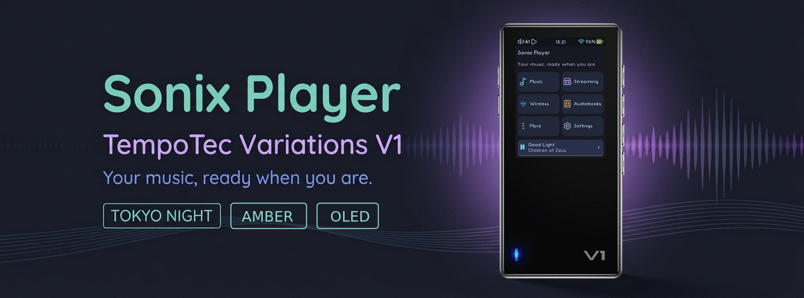
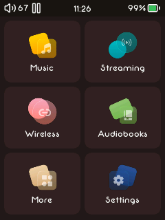
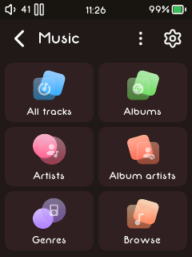
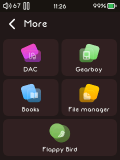
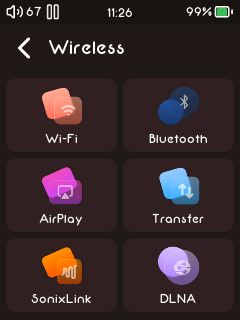
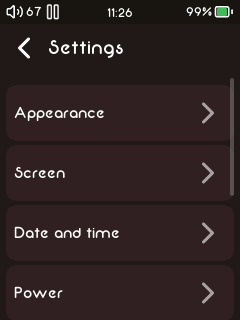
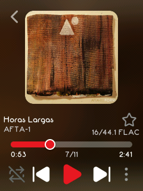
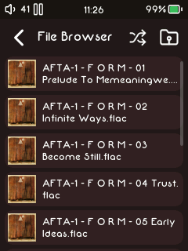
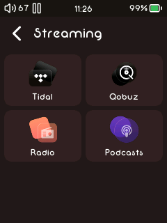
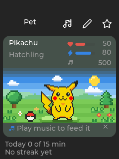

This repository is a community port of the original **[Sonix Player](https://github.com/Jepl4r/sonix-player)** project by **[Jepl4r](https://github.com/Jepl4r)** for the Tempotec Variations V1. 

The firmware builder starts with an official V1 update package, replaces the stock music player and its interface with Sonix, then repackages the update as `v1.upt`.

## Previews

Showcase of the default theme. Click any picture to open it full size. (This is not the default font neither the color)

<table>
  <tr>
    <td align="center">
      <a href="screenshots/main-menu.png"></a>
      <br><sub><b>Main menu</b></sub>
    </td>
    <td align="center">
      <a href="screenshots/music.png"></a>
      <br><sub><b>Music</b></sub>
    </td>
    <td align="center">
      <a href="screenshots/more.png"></a>
      <br><sub><b>More</b></sub>
    </td>
    <td align="center">
      <a href="screenshots/wireless.png"></a>
      <br><sub><b>Wireless</b></sub>
    </td>
  </tr>
  <tr>
    <td align="center">
      <a href="screenshots/settings.png"></a>
      <br><sub><b>Settings</b></sub>
    </td>
    <td align="center">
      <a href="screenshots/now-playing.png"></a>
      <br><sub><b>Now Playing</b></sub>
    </td>
    <td align="center">
      <a href="screenshots/file-browser.png"></a>
      <br><sub><b>File Browser</b></sub>
    </td>
    <td align="center">
      <a href="screenshots/streaming.png"></a>
      <br><sub><b>Streaming</b></sub>
    </td>
  </tr>
</table>

### Tokyo Night theme

Showcase of **Tokyo Night** appearance: a blue-black palette with function-matched icons.
<table>
  <tr>
    <td align="center">
      <a href="screenshots/tokyonight/main-menu.png"></a>
      <br><sub><b>Main menu</b></sub>
    </td>
    <td align="center">
      <a href="screenshots/tokyonight/music.png"></a>
      <br><sub><b>Music</b></sub>
    </td>
    <td align="center">
      <a href="screenshots/tokyonight/more.png"></a>
      <br><sub><b>More</b></sub>
    </td>
    <td align="center">
      <a href="screenshots/tokyonight/wireless.png"></a>
      <br><sub><b>Wireless</b></sub>
    </td>
  </tr>
  <tr>
    <td align="center">
      <a href="screenshots/tokyonight/settings.png"></a>
      <br><sub><b>Settings</b></sub>
    </td>
    <td align="center">
      <a href="screenshots/tokyonight/now-playing.png"></a>
      <br><sub><b>Now Playing</b></sub>
    </td>
    <td align="center">
      <a href="screenshots/tokyonight/file-browser.png"></a>
      <br><sub><b>File Browser</b></sub>
    </td>
    <td align="center">
      <a href="screenshots/tokyonight/streaming.png"></a>
      <br><sub><b>Streaming</b></sub>
    </td>
  </tr>
</table>

### Amber on black theme

Showcase of **Amber** appearance: fiery orange accents on a pure black background, with warm amber artwork and glowing icons.

<table>
  <tr>
    <td align="center">
      <a href="screenshots/ember/main-menu.png"></a>
      <br><sub><b>Main menu</b></sub>
    </td>
    <td align="center">
      <a href="screenshots/ember/music.png"></a>
      <br><sub><b>Music</b></sub>
    </td>
    <td align="center">
      <a href="screenshots/ember/more.png"></a>
      <br><sub><b>More</b></sub>
    </td>
    <td align="center">
      <a href="screenshots/ember/wireless.png"></a>
      <br><sub><b>Wireless</b></sub>
    </td>
  </tr>
  <tr>
    <td align="center">
      <a href="screenshots/ember/settings.png"></a>
      <br><sub><b>Settings</b></sub>
    </td>
    <td align="center">
      <a href="screenshots/ember/now-playing.png"></a>
      <br><sub><b>Now Playing</b></sub>
    </td>
    <td align="center">
      <a href="screenshots/ember/file-browser.png"></a>
      <br><sub><b>File Browser</b></sub>
    </td>
    <td align="center">
      <a href="screenshots/ember/streaming.png"></a>
      <br><sub><b>Streaming</b></sub>
    </td>
  </tr>
</table>

### OLED theme

Showcase of **OLED** appearance: true black backgrounds with white as the accent, on the same V1 layouts as Tokyo Night and Amber.

<table>
  <tr>
    <td align="center">
      <a href="screenshots/oled/main-menu.png"></a>
      <br><sub><b>Main menu</b></sub>
    </td>
    <td align="center">
      <a href="screenshots/oled/music.png"></a>
      <br><sub><b>Music</b></sub>
    </td>
    <td align="center">
      <a href="screenshots/oled/more.png"></a>
      <br><sub><b>More</b></sub>
    </td>
    <td align="center">
      <a href="screenshots/oled/wireless.png"></a>
      <br><sub><b>Wireless</b></sub>
    </td>
  </tr>
  <tr>
    <td align="center">
      <a href="screenshots/oled/settings.png"></a>
      <br><sub><b>Settings</b></sub>
    </td>
    <td align="center">
      <a href="screenshots/oled/now-playing.png"></a>
      <br><sub><b>Now Playing</b></sub>
    </td>
    <td align="center">
      <a href="screenshots/oled/file-browser.png"></a>
      <br><sub><b>File Browser</b></sub>
    </td>
    <td align="center">
      <a href="screenshots/oled/streaming.png"></a>
      <br><sub><b>Streaming</b></sub>
    </td>
  </tr>
</table>


**Tag Manager:** Open More → Tag Manager to view FLAC/MP3 tags and cover art, and edit track titles, artists, track numbers or genres, and search for cover art over Wi-Fi on the V1. See the [usage and safety notes](docs/tag-manager.md).

## Contents

- [Target device](#target-device)
- [Features](#features)
- [Screenshots](#screenshots)
  - [Tokyo Night theme](#tokyo-night-theme)
  - [Ember theme](#ember-theme)
  - [OLED theme](#oled-theme)
- [Music pet](#music-pet)
- [Build a firmware image](#build-a-firmware-image)
- [Install or restore firmware](#install-or-restore-firmware)
- [Streaming credentials](#streaming-credentials)
- [Subsonic / Gonic](#subsonic--gonic)
- [Build from source](#build-from-source)
- [Project files and documentation](#project-files-and-documentation)
- [Credits](#credits)

## Target device

The **TempoTec Variations V1**:

| Component | Specification |
|---|---|
| **SoC** | Ingenic X1600 (MIPS32r2 core, o32 ABI, glibc 2.22 compatibility) |
| **Display** | 2.0-inch QVGA TFT panel, **240×320 pixels** portrait |
| **DAC** | Dual Cirrus Logic CS43131 |
| **Audio Outputs** | 3.5 mm single-ended + 4.4 mm balanced headphone jacks |
| **Storage** | One MicroSD card slot (exFAT / FAT32) |
| **Controls** | Side flank buttons (Power, Vol+, Vol-, Play/Pause, Next/Prev) + capacitive touchscreen |
| **Wireless** | 2.4 GHz Wi-Fi (802.11 b/g/n) and bi-directional Bluetooth |
| **USB** | USB Type-C (bidirectional USB DAC & USB audio out) |
| **Firmware Package** | `v1.upt` with accompanying `v1_md5.txt` |

The player UI is built with LVGL 9.6 and adapted for the V1's small display. The package is based on vendor firmware; it is **not** a Linux distribution or a kernel replacement.

## Features

This fork builds on the upstream [Sonix Player](https://github.com/Jepl4r/sonix-player) for the V1. The items below are **new in this fork**; everything else is shared with upstream. The complete list is in [FEATURES.md](FEATURES.md).

### New in this fork

- **Music pet** - a Pikachu that grows from the music you hear. See [Music pet](#music-pet).
- **Calculator, Notes, Metronome** - a pocket calculator, text notes from the card, and a metronome with tap tempo, all under More.
- **2048, Snake and Dino** - three small games under More, sized for the V1 panel.
- **Tag Manager** - view and edit FLAC and MP3 tags and cover art, and search for covers over Wi-Fi. See the [usage and safety notes](docs/tag-manager.md).
- **Subsonic / Gonic** - stream from your own server. See [Subsonic / Gonic](#subsonic--gonic).
- **V1 themes** - **Tokyo Night**, **Amber on Black** and **OLED**, designed for the V1 panel, beside Dark and Light. Make your own with a [custom colour theme](docs/custom-themes.md).
- **Boot screens** - Retrospace (the default), Space, Travelling in space, Stock, or your own picture.
- **Player layouts** - **Immersive**, **Poster** and **Album Art Max**, beside Standard, Waveform and Alternative.
- **Legacy play button and corner roundness** - the original round disc behind play and pause, as an option under Settings → Music → Display options; and a slider for how round the screen corners are, from a hint of a corner (2 px) up to 20 px, for a V1 that looks boxier than its 16 px default.
- **Interface fonts** - choose MiSans, Neon 80s or Roboto, or any `.ttf`/`.otf` in the card's `Fonts` folder. Missing glyphs fall back to MiSans, so every language stays readable.
- **Dual Scrobbler Suite** (Last.fm & ListenBrainz) — Native background scrobbling for both services with independent toggles, token-based setup, and offline queue caching when disconnected from Wi-Fi.
- **Over-The-Air (OTA) Updates** - Check for and download new releases directly over Wi-Fi from GitHub Releases with one click in Settings → System → Firmware update.
- **SmartMix Playlist**  - Generate similar tracks, tag based playlists!
- **Editable control centre**
- **Many more improvements!**
### Shared with Sonix Player

- **Music**: a local library with a file browser, albums, artists, genres, playlists, favourites and most played, plus gapless playback, fades, ReplayGain and sleep timers.
- **Sound**: a 10-band graphic EQ, parametric EQ, AutoEq, MSEB, crossfeed, DSD and a DAC page.
- **Lyrics**: read from the file or fetched from LRCLIB.
- **Streaming and podcasts**: Tidal, Qobuz, internet radio, Last.fm, and podcasts with downloads.
- **Audiobooks and e-books**: chapters, bookmarks and speed control, plus an EPUB reader.
- **Wireless**: Wi-Fi, Bluetooth headphones and speakers, a Bluetooth receiver, AirPlay, DLNA, Wi-Fi file transfer and SonixLink.
- **Tools and games**: a file manager, a Game Boy / Game Boy Color emulator, and Flappy Bird.
- **Screen and power**: rounded corners (with a choice of how round), brightness, a screensaver, standby, a low-battery warning and a battery screen when off.

Local audio decoder inputs include WAV, FLAC, MP3, Ogg Vorbis, Opus, M4A/M4B/MP4, AAC, ALAC, WavPack, APE, AIFF/AIFC, CAF and DSD (DSF/DFF). Streaming services require valid credentials and may depend on third-party availability.

## Music pet

Open **More → Pet** to meet a small Pikachu that is fed by the music you listen to.

<p align="center">
  
</p>

How it works:

- **Feeding:** the pet grows from listening to something it can actually hear: a local track, a stream, internet radio, or a phone over Bluetooth, at a volume of 10 % or more. Paused or silent playback feeds nothing.
- **Stages:** there is no egg. Pikachu is there from the first minute and grows through four stages: hatchling, child, teen and adult.
- **Meters:** the card shows a heart meter for the pet's mood, an energy meter, and its Musical Notes total. Below them, a line says whether it is hearing music.
- **Daily goal and streak:** a 15-minute daily goal builds a streak. A bought streak freeze covers one missed day.
- **Musical Notes:** the pet earns notes for the minutes it hears, plus bonuses for listening late, finishing an album, five genres in a day, and half an hour without a pause. Spend them in the wardrobe on hats, headphones, a scarf, a crown, room themes and streak freezes.
- **Character:** after about a month of listening, the genres you play give it a character. Pop and dance make it Upbeat, jazz and classical make it Calm, and indie, alternative and metal make it Curious.
- **Tap-along:** once a day it offers a sixteen-beat tap-along using the metronome.
- **Naming:** it starts as Pikachu. Use the pencil in the corner to rename it.

The full rules are in [FEATURES.md](FEATURES.md).

## Install or restore firmware

Only attempt this on a TempoTec Variations V1. Read the warning above before proceeding.

1. Keep the **official V1 `v1.upt` and its matching `v1_md5.txt`** somewhere safe. They are needed if you want to return to stock.
2. Extract the workflow artifact — its name ends in the commit it was built from, and `BUILD-REPORT.txt` inside repeats it — and copy **both** `v1.upt` and `v1_md5.txt` to the root of a microSD card supported by the device. On a release, the uploaded `v1.upt` is always built from that release's own tag; if `BUILD-REPORT.txt` names another commit, the artifact is not the release's and should not be flashed as it.
3. Charge the player adequately, insert the card and start the device's built-in firmware update process. Menu names vary by stock firmware version; follow the device's on-screen instructions and do not interrupt the update.
4. If you want to restore stock firmware, put the original vendor `v1.upt` and its matching checksum file at the card root and use the same update process.

The build workflow defaults to the bundled official V1 1.3 OTA (`sonix-packer/firmware-input/v1.zip.part1` and `.part2`); an optional workflow URL selects a different stock image. See [stock firmware input](sonix-packer/firmware-input/README.md) for local preparation and checksums. An image built on 1.3 keeps the 1.3 kernel and the package's `ota_compatibility.in` marker byte-for-byte, and works on a V1 running stock firmware 1.3.

The package builder is designed to preserve the stock `xImage` kernel and leave the existing update/recovery path in place. This is checked during the build, but it is **not** a guarantee that recovery will work on every device or in every failure case.

## Streaming credentials

Credentials for Qobuz, Tidal, Podcast Index and Last.fm are not included in this repository or in the standard workflow artifact. Without usable credentials, those services remain disabled; local playback does not require them.

To try credentials on a build that has no keys embedded, copy `sonix-player/streaming-keys.ini.example` to the root of the microSD card as `streaming-keys.ini`, fill in only the services for which you have authorized credentials, then restart the player. Do not commit or share this file.

```ini
[qobuz]
app_id =
app_secret =

[tidal]
client_id =
client_secret =

[podcast]
api_key =
api_secret =

[lastfm]
api_key =
api_secret =
```

ListenBrainz is the one scrobbler that needs no credentials in the image: its account is a personal user token, requested on listenbrainz.org/settings and pasted into the player's Settings → Music → ListenBrainz. Only the token is kept on the device. Scrobbling to Last.fm and to ListenBrainz are independent and can run side by side.

#### Qobuz without keys of your own

Qobuz does not issue application credentials for personal or open-source clients, which is why the stock V1 firmware works out of the box: its `hiby_player` carries HiBy's own `app_id`/`app_secret` internally. Sonix already speaks that exact authentication flow; it only lacks the credential pair, which belongs to HiBy and is neither committed nor shipped in published images.

When you build an image **for your own device** from the official stock firmware, the packer can extract that pair from the stock binary and install it automatically — no `streaming-keys.ini` on the card:

```sh
SONIX_EMBED_STOCK_KEYS=1 ./sonix_firmware_packer.sh
```

With a `streaming-keys.key` present the credentials are sealed into `streaming-keys.bin`; without one they ship as a plain, player-readable `streaming-keys.ini`. The extractor only runs on this explicit opt-in, masks values in its output, and leaves Tidal on the manual path (its secret is assembled at run time in the stock binary and cannot be scanned out). **An image built this way carries a third party's API credentials: keep it private, never upload it to a release.** The standalone tool (`sonix-player/tools/extract_streamkeys.py`, with `--check` and `--list-candidates`) and the full investigation, including what was traced in the stock binary, are documented in [docs/qobuz-stock-firmware.md](docs/qobuz-stock-firmware.md).

### Your own server with a self-signed certificate

A home server with a self-signed certificate — the usual setup for Subsonic/Gonic, and something no CA bundle can ever validate — is refused by default. **Accept self-signed certificates** under **Streaming → Subsonic → Server settings** lets it through, without `adb` and without a restart. The same thing can be set in `/usr/data/device_config.ini`:

```ini
[network]
tls_verify = relaxed
```

**Relaxed** forgives a certificate whose issuer is not in the trust store, and nothing else: the certificate still has to name the server being contacted, and its dates still have to cover the current date, so an expired certificate or one issued to a different name fails and says so. A certificate error that names a date usually means the player's clock is wrong, not that the mode is missing.

The setting is global — it applies to every `https://` connection the player opens, radio stations included — because one TLS context serves them all. Anyone using a public network should leave it at the default, `strict`. A private certificate authority is better handled with `[network] ca_bundle` above, which keeps checking on: export the CA's own certificate, copy that file to the card, and point `ca_bundle` at it.

For a private development build, `sonix-player/tools/seal_streamkeys.py` can place a sealed credentials file in the assets before compilation. This format is **obfuscation, not secure encryption**: the key is compiled into the player binary and can be recovered by someone who analyzes it. Never publish a binary containing credentials you do not intend to disclose.

## Subsonic / Gonic

**Streaming → Subsonic → Server settings** connects to your own Subsonic-compatible server, including Gonic. Enter its base URL and your account, then select **Connect / save**. Browse Music folders or Artists and select a track to play the current page.

MP3 at **256 kbps** is the default; **320 kbps**, **Opus**, and **Raw** (original FLAC/MP3/Opus) are available. Transcoding must be enabled on the server. Network workers feed two fixed **1 MiB RAM rings**, refill at about 50%, and pre-cache the next track's first **512 KiB** near 90% progress. There is no disk audio cache, localhost proxy, or socket read in the decoder.

No application API key is needed. Prefer HTTPS; credentials stay in memory unless explicitly remembered, and remembered passwords are stored **unencrypted** in a private device-local file. A server with a self-signed certificate needs **Accept self-signed certificates** on its settings page — see [your own server with a self-signed certificate](#your-own-server-with-a-self-signed-certificate). Seeking and reboot restoration are not available for these ephemeral streams. Compatible-format gapless handoff uses the existing ALSA path; network, codec timing and physical-device limits still apply.

See [setup, design, limitations and the V1 validation checklist](docs/subsonic.md), and [host integration tests](sonix-player/tests/README.md).

## Project files and documentation

- `sonix-player/` — player sources, LVGL configuration, launcher and build system.
- `sonix-packer/` — stock-image preparation, firmware packaging and validation scripts.
- `docs/collecting-logs.md` — which logs to send with a bug report, and how to take them.
- `docs/subsonic.md` — Subsonic/Gonic setup, RAM transport and hardware validation.
- `docs/sgm31324-led-control.md` — driving the RGB status LED directly over I²C.
- `sonix-player/tools/sonix-bugreport.sh` — one-file diagnostic bundle, run on the device over ADB.
- `FEATURES.md` — detailed feature notes.
- `PATCHES.md` — device-porting and implementation notes.
- `LICENSE` — GNU General Public License, version 3. Third-party components retain their own licenses.

For bug reports, include the exact model, the firmware build/commit and relevant logs — see [Collecting logs for a bug report](docs/collecting-logs.md) for what to turn on and where the files are. Remove personal data and **never attach streaming credentials**.

## Credits

This port exists because of the original **[Sonix Player](https://github.com/Jepl4r/sonix-player)** project. Almost everything in `sonix-player/` and `sonix-packer/` is that project's work, carried here and adapted; what this fork adds is the TempoTec V1 support and the documentation for it. The original is licensed under the GPL-3.0, and so is this fork.


